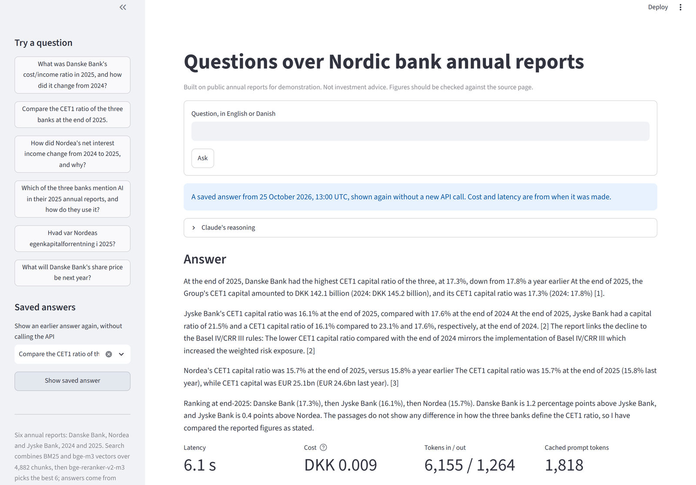
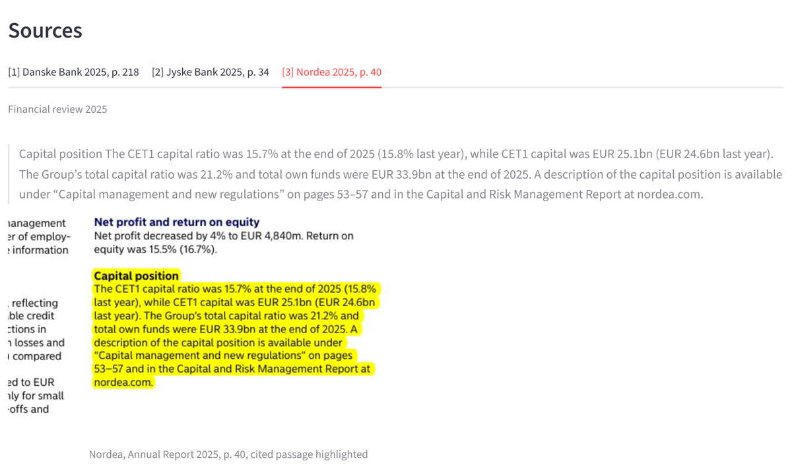
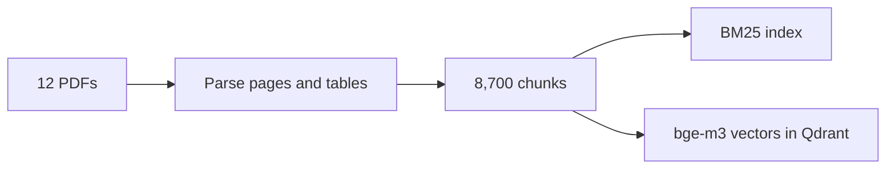
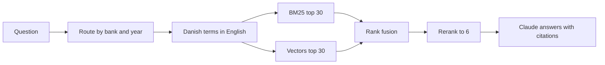

# Nordic Bank Report RAG

I built a question answering system over the 2022 to 2025 annual reports of Danske Bank, Nordea and Jyske Bank: twelve reports, 3,553 PDF pages. Ask a question in English or Danish and it answers from the reports, cites the report and page behind every claim, and refuses forecasts and investment advice. A test set of 44 questions with known answers measures every part of it.

Not investment advice. Figures should be checked against the source page.



## Headline results

Measured on 44 eval questions, 35 of them answerable from the reports ([evals/RESULTS.md](evals/RESULTS.md)):

- **Recall@6 0.94** with hybrid search and a reranker, against 0.77 for keyword search alone: the 6 passages Claude reads hold the needed evidence 95% of the time, counting each bank or year a question needs.
- **27 of 28 numeric answers exact.**
- **9 of 9 unanswerable questions refused**, and no answerable question refused.
- **USD 0.001 (DKK 0.007) and about 5 seconds per question**, with Claude Haiku 5.5 and local open models for search.

## What an answer looks like

From the last eval run ([evals/ANSWERS.md](evals/ANSWERS.md#q30)), as the web page shows it. Text in quotation marks is copied word for word from the cited page, and `[1]` points to the source:

> **What net profit does Danske Bank expect for 2026, according to its 2025 annual report?**
>
> For 2026, Danske Bank's own projection is a net profit of DKK 22-24 billion. The report links this to a return on equity above the bank's 2026 ambition of 13%. This is the bank's expectation as stated in its report, not a forecast from me. “Net profit is expected to be in the range of DKK 22-24 billion, reflecting a return on equity above our 2026 ambition of 13%.” [1]
>
> [1] Danske Bank, Annual Report 2025, p. 6, Executive summary

A question such as "What will Danske Bank's share price be next year?" gets "Not in the documents." and an explanation that the system only reports what the reports say.

The web page shows the same answer with Claude's reasoning summary, the cost and time, and each cited report page as an image with the cited passage highlighted. Here is source [3] of the CET1 answer above, Nordea's report, page 40:



## How it works

Once, with `bankrag ingest`:



For each question:



1. **Parse.** PyMuPDF reads every page. Tables are rebuilt row by row from word positions, because the library's own cell output merged columns on many report tables. Each page keeps its bank, year, PDF page number and section. Each report is parsed in a child process that restarts after a crash, because PyMuPDF's layout model crashed the process on 3 of the 3,553 pages.
2. **Chunk.** Paragraphs are packed into chunks of about 500 tokens that never cross a page, so every chunk cites one page. A table is never split unless it is very long. That gives 8,700 chunks.
3. **Route.** The question's bank and year names become filters. A question about three banks is searched once per bank and the results are interleaved, so one bank cannot take every slot.
4. **Expand Danish.** A glossary of 25 Danish finance terms adds the English wording the reports use ("egenkapitalforrentning" adds "return on equity").
5. **Search twice and fuse.** BM25 matches exact terms and figures. Dense vectors from `BAAI/bge-m3`, stored in embedded Qdrant, match meaning across languages. Reciprocal rank fusion merges the two rankings by rank, not score.
6. **Rerank.** The cross-encoder `BAAI/bge-reranker-v2-m3` reads the question and each of the top 30 passages together and keeps the best 6. Both models run locally, on the GPU when there is one.
7. **Answer.** Claude Haiku 5.5 gets the 6 passages as `search_result` blocks with citations turned on, and a cached system prompt with the rules: answer only from the passages, cite every figure, answer Danish questions in Danish, refuse forecasts and advice, but report a bank's own published outlook.
8. **Log.** Every answer goes to `data/traces/answers.jsonl` with its sources, tokens, cost and latency.

Next to the answers sits a **KPI table** ([kpi/figures.yaml](kpi/figures.yaml)): net profit, total income, cost/income ratio, return on equity, CET1 ratio, loan impairment charges and lending, for each bank and year. Each of the 42 figures has its page and the exact table row it came from. Claude Haiku read them with structured output from each report's key figure pages and the search results, for USD 0.05 in total. Three automatic checks (the page was sent, the row is on the page, the value is in the row) passed on all 42, and the figures agree with every gold answer that states the same number. They are marked `verified: false` until I have checked them against the PDFs. `bankrag kpi show` prints the table from SQLite, which the MCP server will query.

The reasons behind each choice are in [docs/decisions.md](docs/decisions.md). A study guide to the concepts (BM25, embeddings, rank fusion, rerankers, citations, the eval metrics, and the banking terms in the reports) is in [docs/concepts.md](docs/concepts.md).

## Try it

### What you need

- [uv](https://docs.astral.sh/uv/getting-started/installation/), which also installs Python 3.12, and git.
- About 10 GB of free disk: the two local models are 2.3 GB each, and PyTorch with CUDA is several GB. The reports, parsed pages and index take about 280 MB.
- An NVIDIA GPU is optional. On Windows uv installs the CUDA 13.0 build of PyTorch; on Linux the CPU build. I built and measured everything on Windows 11 with an RTX 5070. On a CPU the search works but is slower, and I have not measured how much. macOS is untested.
- An [Anthropic API key](https://console.anthropic.com/) for answers only. Search and the retrieval evals need no key.

### Steps

```bash
git clone https://github.com/AndersHenriksen-dev/nordic-bank-report-rag.git
cd nordic-bank-report-rag
make setup          # uv sync, and the pre-commit hooks
make download       # the twelve PDFs into data/raw/, checked against their SHA-256
```

Jyske Bank's website blocks scripted downloads. For its four reports the script prints the URL: open it in a browser, save the PDF under the name the script gives in `data/raw/`, and run `make download` again to check it.

```bash
make ingest         # parse, chunk and index: about 55 minutes the first time
```

Parsing is the slow part, and its result is cached per report. The first run also downloads `bge-m3` from Hugging Face and builds the vector index (about 2 minutes on my GPU, including the download). Running `ingest` again parses only reports without a cache, and rebuilds the index only when the chunks or the embedding model changed.

Search without an API key:

```bash
uv run bankrag search "What was Nordea's CET1 ratio at the end of 2025?"
uv run bankrag search "Hvad var Nordeas egenkapitalforrentning i 2025?" --retriever bm25
```

It prints the top passages with their page and score. `--retriever` takes `bm25`, `dense`, `hybrid` or `hybrid-rerank` (the default), so you can compare them on your own questions. The first search downloads the reranker.

`uv run bankrag kpi show` prints the KPI table, also without a key. `bankrag kpi extract` reads it again with Claude (about USD 0.05) and keeps every figure already marked `verified: true`.

Then add the API key and ask:

```bash
cp .env.example .env          # then put your key after ANTHROPIC_API_KEY=
make ask Q="How did Nordea's net interest income change from 2024 to 2025, and why?"
make app                      # the web page on http://localhost:8501
```

The web page listens on localhost only, because every question spends the key's credit. Qdrant runs inside the process and locks its folder, so run one of the web page, the CLI or the evals at a time.

Every answer is logged to `data/traces/answers.jsonl`, and the web page's "Saved answers" menu shows any of them again, with its reasoning, sources and highlighted pages, without calling the API or loading the search models. After `make eval` that includes all 44 eval questions, which is how the screenshots above were made.

### Use it from Claude Desktop or Claude Code (MCP)

`make mcp` starts a read-only MCP server over stdio with three tools:

- `search_reports(query, bank?, year?, k?)`: the passages the reranked search finds, with bank, year, PDF page and section, so Claude can cite them.
- `get_kpi(bank, metric, year)` and `compare_banks(metric, year)`: figures from the KPI table, with page and source row.

The server makes no API calls: Claude writes the answer from what the tools return, so the tools cost nothing. It needs the ingested data, like the CLI, and the first search takes about 12 seconds while the models load.

Claude Code:

```bash
claude mcp add bankrag -- uv --directory /path/to/nordic-bank-report-rag run bankrag-mcp
```

Claude Desktop, in `claude_desktop_config.json`:

```json
{
  "mcpServers": {
    "bankrag": {
      "command": "uv",
      "args": ["--directory", "/path/to/nordic-bank-report-rag", "run", "bankrag-mcp"]
    }
  }
}
```

While the server has searched, it holds the vector index's lock, like the web page: close it before running the evals.

### Evals

```bash
make eval-retrieval   # recall@k and MRR for 8 search setups, free, a few minutes
make eval             # also answers all 44 questions and grades them with the judge: about USD 0.05
```

Both write [evals/RESULTS.md](evals/RESULTS.md), with a chart of the retrieval comparison; the full run also writes [evals/ANSWERS.md](evals/ANSWERS.md) with every question, gold answer, answer, cited passage and verdict.

### Settings

All optional, in `.env`:

| Variable | Default | What it changes |
|---|---|---|
| `BANKRAG_MODEL` | `claude-haiku-5-5` | The answer model |
| `BANKRAG_JUDGE_MODEL` | `claude-haiku-5-5` | The eval's LLM judge |
| `BANKRAG_EMBED_MODEL` | `BAAI/bge-m3` | The embedding model; changing it rebuilds the index on the next `ingest` |
| `BANKRAG_RERANK_MODEL` | `BAAI/bge-reranker-v2-m3` | The reranker |
| `BANKRAG_USD_TO_DKK` | `6.8` | The fixed rate for costs in DKK |

### Development

```bash
make check    # ruff, ruff format, mypy and pytest: what CI runs
```

The 67 tests need no API key, models or PDFs: they use small fakes, an in-memory Qdrant and a fake HTTP transport for the Claude API. Pre-commit runs ruff, mypy and a gitleaks secret scan on every commit, and GitHub Actions runs the checks and the secret scan on every pull request.

## How it is measured

The eval set ([evals/questions.yaml](evals/questions.yaml)) has 44 questions: 10 lookups, 6 comparisons across years, 6 across banks, 7 "why" questions, 6 Danish questions and 9 that the reports cannot answer (forecasts, advice, years not covered). Each answerable question has a gold answer and the PDF pages that hold it, checked in the page text.

- **Retrieval:** recall@k (the share of a question's needed evidence found in the top k passages) and MRR (how high the first right page ranks).
- **Numbers:** every figure the gold answer requires must appear in the answer, within rounding.
- **Grounding:** every figure in an answer must appear in a passage the answer cites.
- **Refusals:** unanswerable questions must be refused, answerable ones must not.
- **LLM judge:** Claude grades each answer as correct, complete and consistent against the gold answer, by a [written rubric](evals/judge_rubric.md). It catches what figure checks cannot, such as a comparison that contradicts itself.
- **Cost and latency:** mean and 95th percentile per question.

## What I tried

Each step was measured on the 35 answerable questions, searching all twelve reports. Claude reads the top 6 passages.

| Step | Recall@1 | Recall@3 | Recall@6 |
|---|---|---|---|
| BM25 over fixed 500-token windows | 0.14 | 0.25 | 0.39 |
| + chunks that follow sections and keep tables whole | 0.19 | 0.28 | 0.47 |
| + search only the banks and years the question names | 0.23 | 0.44 | 0.68 |
| + English report wording for Danish finance terms | 0.23 | 0.53 | 0.77 |
| Dense vectors (`bge-m3`) alone, for comparison | 0.24 | 0.57 | 0.74 |
| BM25 and dense fused by reciprocal rank fusion | 0.39 | 0.68 | 0.82 |
| + cross-encoder reranker (`bge-reranker-v2-m3`) on the top 30 | **0.50** | **0.84** | **0.94** |

Answers on all 44 questions with the reranked search and Claude Haiku 5.5 (the latest of two runs, made before the 2022 and 2023 reports were added):

- 27 of 28 numeric answers exact, and 26 of 32 answers with every figure in a cited passage (29 in the run before).
- All 9 questions the reports cannot answer refused, and no answerable question refused.
- The LLM judge passed 27 of 35 answers as correct, complete and consistent. Reading the 8 fails, 7 are real faults.
- USD 0.001 and 5 s per question, plus USD 0.0002 per judge verdict.

What I take from it:

- **More reports barely moved the search.** Doubling the corpus to twelve reports changed recall@6 from 0.95 to 0.94, because routing sends every question that names a year to that year's reports.
- **Search quality came from the documents and the search, not the model.** Rebuilding tables row by row, routing by bank and year, and reranking moved the numbers; the answer model stayed the cheapest one.
- **Dense vectors alone do not replace BM25 on annual reports**, which are full of exact terms and figures. They put the right page first about as often (recall@1 0.24 against 0.23) but find less of the evidence in the top 6 (0.74 against 0.77). Fused with BM25 they put the right page first 70% more often, and the reranker more than doubles BM25's rate (0.50 against 0.23).
- **The eval had to be debugged too.** My first citation metric scored 50%, but it measured my gold page lists more than the answers. Its replacement checks that every figure in an answer appears in a passage the answer cites. Better searches also kept finding pages that hold the answer but were missing from my gold lists; each one is checked in the page text before it is added.
- **A judge needs checking too.** The LLM judge caught comparisons that contradict themselves and business-unit figures offered as the group's, which no figure check could see. At low effort it also failed 3 good answers, and a sharper rubric alone only moved those errors around. Judging the same answers at medium effort cut the wrong verdicts to 1 of 34.
- **Where it breaks:** group versus business-unit pages (the answer offers a business unit's figure next to the group's and will not choose), paragraphs the parser splits into pieces so a citation covers only part of a sentence, and sentences quoted without a citation marker. My first refusal rule also refused questions about a bank's own published outlook; a new eval question caught it, and the fix removed the last wrong refusal.

Every strategy, with its numbers and what I kept, is in [docs/experiments.md](docs/experiments.md).

## Repository layout

```
src/bankrag/
    cli.py                 bankrag ingest | search | ask
    config.py              paths, model names, prices
    models.py              Pydantic models for everything that crosses a boundary
    figures.py             number parsing in English and Danish formats
    ingest/                PDF parsing, chunking, the crash-safe pipeline
    retrieve/              BM25, Qdrant vectors, fusion, reranking, routing, Danish glossary
    answer/generate.py     the Claude call with citations, refusals, cost and the trace log
    kpi/                   the KPI table: extraction with structured output, automatic checks, SQLite queries
    judge.py               the LLM judge
    evaluate.py            recall@k, MRR, number and grounding checks
    ui/                    the Streamlit page and the passage highlighter
    mcp_server.py          the read-only MCP server: report search and the KPI table
evals/                     questions, judge rubric, the eval runner and its generated results
kpi/figures.yaml           the 42 key figures with page and source row, for review by hand
scripts/                   download the reports; search the parsed pages; retrieval per eval question
tests/                     unit tests, no network or models needed
docs/                      decisions, experiments, documents, concepts, build log
.claude/                   Claude Code setup: style guide, hook, two project skills, a subagent, permissions
```

## How I built it

I built this with Claude Code in about 9 hours over two days, of which about 1.6 hours was parsing that ran in the background. [docs/BUILD_LOG.md](docs/BUILD_LOG.md) has one row per session: what was built, what Claude Code did, where it got something wrong, and what I decided.

The `.claude` folder is part of the repository, and each piece exists because it made the work faster or safer:

- **[CLAUDE.md](CLAUDE.md)** gives every session the rules: how to run things, never commit data or keys, ask before any paid API run, refuse investment advice, every new feature gets an eval case. The build log lists what each paid run cost; all of them together came to about USD 0.31.
- **A [Python style guide](.claude/reference/python-style.md) and a hook** that blocks an agent from editing Python before it has read the guide. Ruff, mypy and pre-commit then catch what a tool can check, before a commit.
- **[add-eval-case](.claude/skills/add-eval-case/SKILL.md)**, a project skill, makes every eval question's figures and pages checked in the parsed report text. It was used for all 17 questions added in milestone 2, and those checks found a restatement, four different employee counts in one report, and pages missing from gold lists.
- **[run-evals-and-report](.claude/skills/run-evals-and-report/SKILL.md)**, a project skill, is the loop that keeps the docs honest: run the free evals, find the questions behind every changed number, check unexpected pages in the text, update the docs. It was written down after doing that by hand for every change from the hybrid search to the twelve reports.
- **[eval-reviewer](.claude/agents/eval-reviewer.md)**, a subagent, reads failed eval cases and sorts each by cause: retrieval, parsing, generation, gold answer or judge. That is the review I did by hand for the LLM judge's verdicts, written down so it can run on its own.
- **[Permissions](.claude/settings.json)** deny reading `.env`, allow the free read-only scripts without asking, and always ask before the commands that spend money.

Not done yet: retrieval evals in CI against a small index fixture, a screen recording of the MCP server in Claude Desktop, a test from a clean clone, and my own check of every gold answer and KPI figure against the PDFs (all are marked `verified: false` until then).

## Disclaimer

Built on public annual reports for demonstration. Not investment advice. Figures should be checked against the source page.

The annual reports belong to the banks. This repository does not contain them: `scripts/download.py` fetches them from each bank's investor relations site. The code is MIT licensed.
